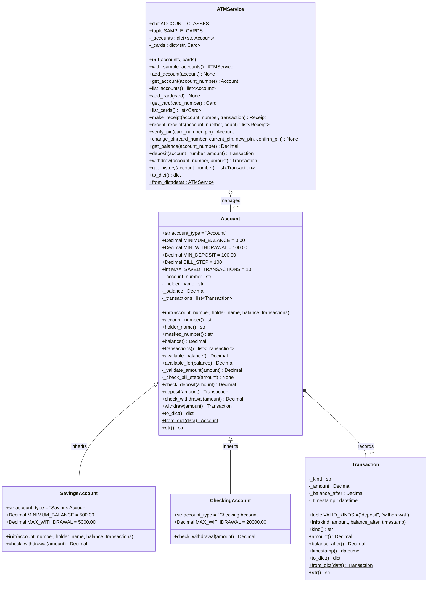

# ATM Simulator — UML Class Diagram

This document provides the Object-Oriented Programming (OOP) class diagram and reference tables for the core banking classes in `atm_app/atm_classes.py`.

## Class Diagram

---

## Key Attributes and Methods by Class

### 1. `Account` (Base Class)
Parent class representing a bank account with encapsulated state and shared deposit/withdrawal validation rules.

* **Class Constants:**
  * `account_type = "Account"`
  * `MINIMUM_BALANCE = Decimal("0.00")`
  * `MIN_WITHDRAWAL = Decimal("100.00")`
  * `MIN_DEPOSIT = Decimal("100.00")`
  * `BILL_STEP = Decimal("100")`
  * `MAX_SAVED_TRANSACTIONS = 10`
* **Private Attributes & Read-Only Properties (`@property`):**
  * `_account_number` / `account_number`: Account identifier string.
  * `_holder_name` / `holder_name`: Stripped name of the account owner.
  * `masked_number`: Account number masked as `****` followed by the last 4 digits.
  * `_balance` / `balance`: Current account balance (`Decimal`), protected from direct external mutation.
  * `_transactions` / `transactions`: Returns a shallow copy of the `Transaction` list so external code cannot mutate history.
  * `available_balance`: Spendable balance (`balance - MINIMUM_BALANCE`, never below `0.00`).
* **Key Methods:**
  * `_validate_amount(amount)` & `_check_bill_step(amount)`: Internal helpers ensuring positive `Decimal` amounts in multiples of PHP 100.
  * `check_deposit(amount)` & `deposit(amount)`: Validates deposit rules, creates a `Transaction`, updates `_balance`, and appends to `_transactions`.
  * `check_withdrawal(amount)` & `withdraw(amount)`: Validates base withdrawal rules (`MIN_WITHDRAWAL`, `BILL_STEP`, overdraft check), creates a `Transaction`, and deducts from `_balance`.
  * `to_dict()` & `from_dict(data)`: Serializes account state (and up to the 10 newest transactions) to a plain dictionary and reconstructs the appropriate `Account`, `SavingsAccount`, or `CheckingAccount` subclass.

### 2. `SavingsAccount(Account)` (Child Class)
Inherits from `Account` and enforces a maintaining balance and a lower per-withdrawal cap.

* **Class Constants:**
  * `account_type = "Savings Account"`
  * `MINIMUM_BALANCE = Decimal("500.00")`
  * `MAX_WITHDRAWAL = Decimal("5000.00")`
* **Overridden Methods:**
  * `__init__(account_number, holder_name, balance="0", transactions=None)`: Calls `super().__init__(...)` and rejects opening balances below PHP 500.00 (`InvalidAmountError`).
  * `check_withdrawal(amount)`: Calls `super().check_withdrawal(amount)`, then raises `InsufficientFundsError` if `balance - amount < 500.00` or `WithdrawalLimitError` if `amount > 5000.00`.

### 3. `CheckingAccount(Account)` (Child Class)
Inherits from `Account` with no maintaining balance (`MINIMUM_BALANCE = Decimal("0.00")`) and a higher per-withdrawal cap.

* **Class Constants:**
  * `account_type = "Checking Account"`
  * `MAX_WITHDRAWAL = Decimal("20000.00")`
* **Overridden Methods:**
  * `check_withdrawal(amount)`: Calls `super().check_withdrawal(amount)`, then raises `WithdrawalLimitError` if `amount > 20000.00`.

### 4. `Transaction`
Immutable record of a single completed deposit or withdrawal.

* **Class Constants:**
  * `VALID_KINDS = ("deposit", "withdrawal")`
* **Private Attributes & Read-Only Properties (`@property`):**
  * `_kind` / `kind`: `"deposit"` or `"withdrawal"`.
  * `_amount` / `amount`: Transaction amount (`Decimal`).
  * `_balance_after` / `balance_after`: Account balance immediately after the transaction (`Decimal`).
  * `_timestamp` / `timestamp`: `datetime` of the operation (without microseconds).
* **Key Methods:**
  * `to_dict()` & `from_dict(data)`: Converts the transaction to/from a JSON-serializable dictionary for Django session storage.

### 5. `ATMService`
Service facade that holds accounts and cards and executes ATM operations on them.

* **Class Constants:**
  * `ACCOUNT_CLASSES`: Maps `"Savings Account"` to `SavingsAccount` and `"Checking Account"` to `CheckingAccount`.
  * `SAMPLE_CARDS`: Default demo card numbers, linked account numbers, and starting PINs.
* **Private Attributes:**
  * `_accounts`: Dictionary mapping `account_number -> Account` instance.
  * `_cards`: Dictionary mapping `card_number -> Card` instance.
* **Key Methods:**
  * `with_sample_accounts()`: Factory classmethod creating the sample `SavingsAccount` (`1001`) and `CheckingAccount` (`2001`) with demo cards.
  * `add_account(account)`, `get_account(account_number)`, `list_accounts()`: Account registry management.
  * `get_balance(account_number)`, `deposit(account_number, amount)`, `withdraw(account_number, amount)`, `get_history(account_number)`: Delegates operations polymorphically to the target `Account` object.
  * `to_dict()` & `from_dict(data)`: Serializes and restores all managed accounts and cards for the Django session.